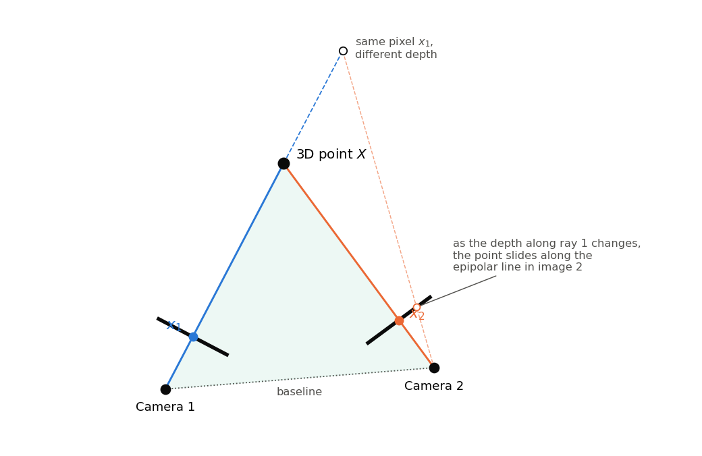
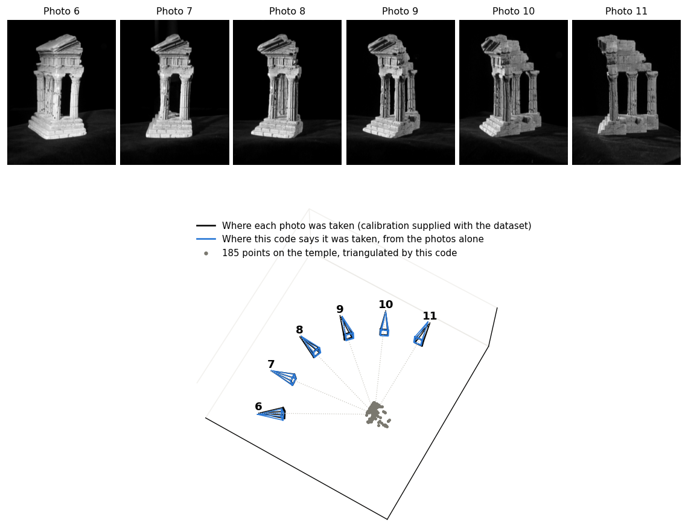
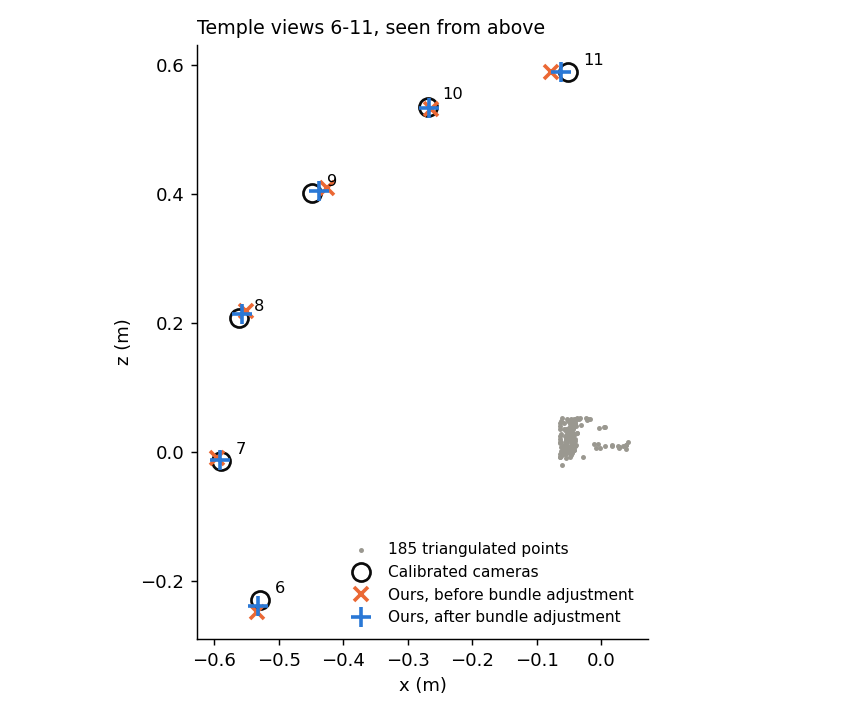
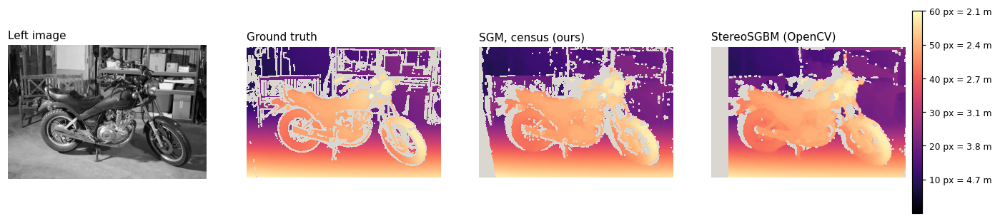
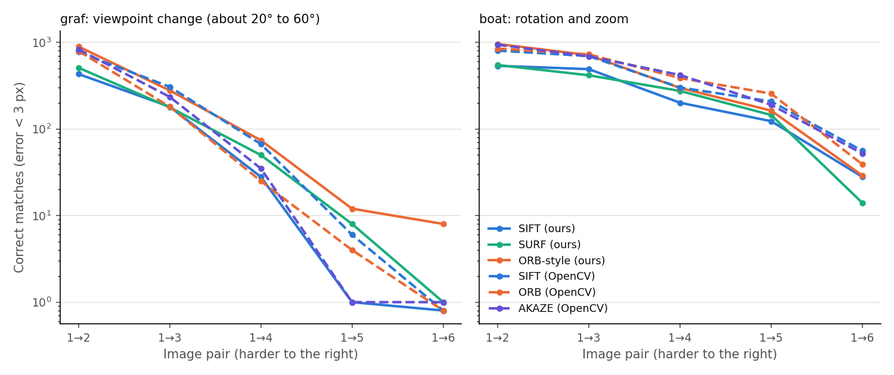
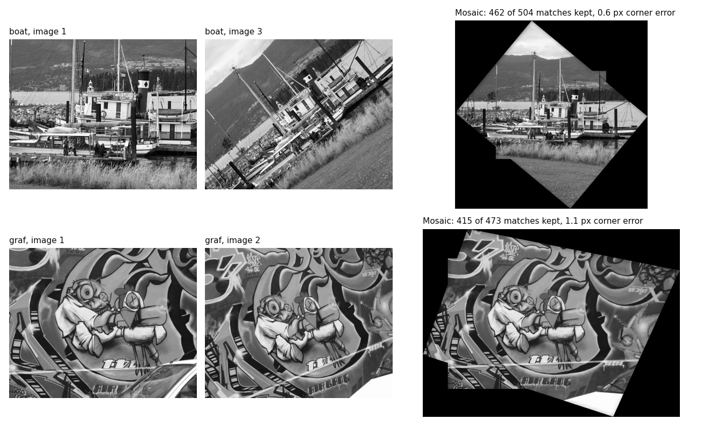
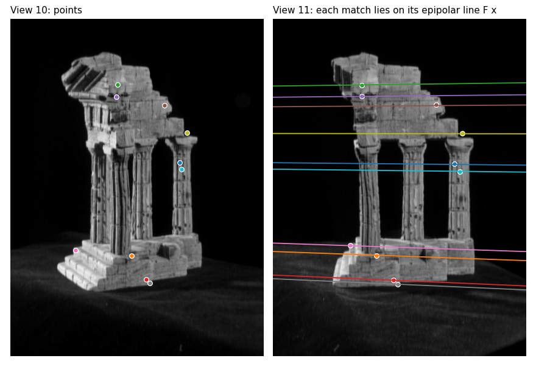
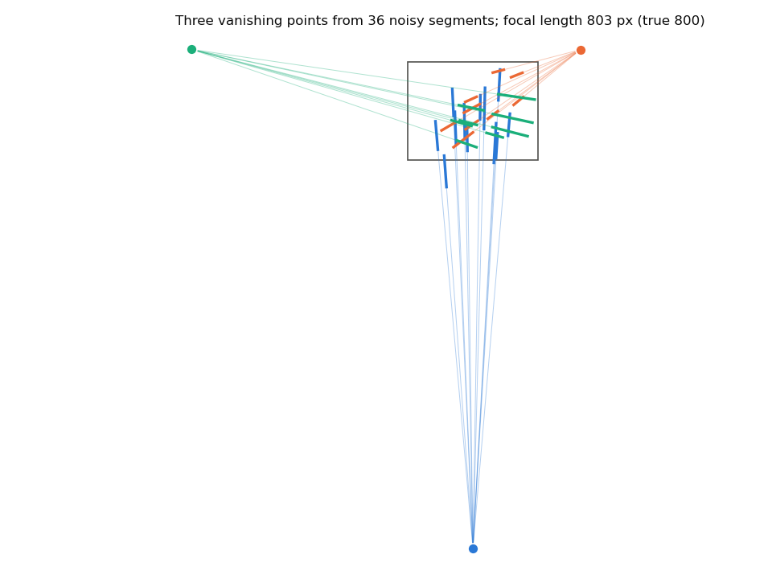

# Multi-View Geometry

[](https://github.com/mstftmk/multi-view-geometry/actions/workflows/tests.yml)

Photogrammetry and multiple view geometry written from scratch in NumPy: features, homographies, stitching, vanishing points, calibration, two-view geometry, stereo, PnP and bundle adjustment. Every method comes with its derivation in [`docs/math/`](docs/math), is tested against synthetic data with a known answer, and is measured against OpenCV on standard datasets with ground truth.

## What is multi-view geometry?

A photo is a 2D record of a 3D scene. Multi-view geometry is the maths of going back: from several photos, work out where the cameras were and where the points of the scene are. It is behind photogrammetry, 3D scanning from photos, panoramas, visual SLAM in robots and augmented reality.

**One camera.** A camera maps a 3D point $X$ to a pixel $x$:

$$
x \sim K\,[R \mid t]\,X
$$

$R$ and $t$ say where the camera is and which way it points, and $K$ holds its focal length and image centre. The $\sim$ means "equal up to scale": every point along the ray through a pixel lands on that same pixel, so a single photo loses depth.

**Two cameras.** Seen from two places, the two rays to the same point cross at the point, which gives back its depth (triangulation). Even before the point is known, the geometry restricts where its match can be: as the depth along the first ray changes, the point's image in the second camera slides along a line, the **epipolar line**. For matching pixels $x_1$ and $x_2$:

$$
x_2^\top F\, x_1 = 0
$$

The $3 \times 3$ matrix $F$ holds the relative position of the two cameras. Eight or more matches determine it, and from it come the rotation between the cameras and the direction they moved in. When the two cameras face the same way side by side, as in a stereo rig, a point simply shifts along its row, and the shift (the **disparity** $d$) gives its depth directly: $Z = f B / d$, with $f$ the focal length and $B$ the distance between the cameras.



**When one image maps onto another.** If the scene is flat, or the camera only rotates in place, every pixel moves by the same $3 \times 3$ matrix, a **homography**: $x_2 \sim H x_1$. This is how panoramas and document scanners line images up.

**Many cameras.** With many photos, all camera poses and all points are refined together, so that each point lands as close as possible to where it was actually seen. This is **bundle adjustment**:

$$
\min_{R_i,\, t_i,\, X_j} \sum_{i, j} \left\lVert x_{ij} - \pi(K, R_i, t_i, X_j) \right\rVert^2
$$

where $x_{ij}$ is where point $j$ was seen in photo $i$, and $\pi$ is the projection above.

**The usual pipeline**, and what this repository implements: find distinctive points in each image (features), match them between images, estimate the geometry while ignoring wrong matches (RANSAC), recover the cameras and the 3D points, and refine everything with bundle adjustment.

### An example from start to finish

The [Middlebury "temple"](https://vision.middlebury.edu/mview/data/) is a plaster model, about 16 cm long, of the Temple of the Dioskouroi in Agrigento. It was photographed from 16 positions on a ring around it, and the dataset gives each camera's exact position from calibration. Here, six neighbouring photos (6 to 11, about 23° apart) go in, together with the focal length. Everything else is found from the images by this code: its own features and matches, the first two cameras from the essential matrix, each further camera by PnP, the 3D points by triangulation, and finally bundle adjustment.



*The cameras were rolled by about 90°, so the photos are shown turned upright; the computations use them as recorded. Black: where each photo was really taken. Blue: where this code places it, from the photos alone. The median difference is 1.3° in camera orientation and 3.7% of the distance between neighbouring cameras in position. The grey points are 185 points on the temple's surface, triangulated by the code. The scale of the blue reconstruction is unknown from images alone, so it is matched to the black one before comparing.*

## Results

| Topic | Result | Data |
|---|---|---|
| Homography | Hartley normalisation: condition number 3.9 instead of 945,000, mean error 0.62 px instead of 4.79 px | 200 synthetic homographies, 1 px noise |
| Features | Our SIFT and ORB-style features match OpenCV's precision (graf 1→2: 0.88 vs 0.87 for SIFT, 0.91 vs 0.92 for ORB) | Oxford graf and boat |
| Mosaics | Homography from our features: 0.6 px (boat 1→3) and 1.1 px (graf 1→2) corner error against the true homography | Oxford graf and boat |
| Vanishing points | Focal length 803 px from three vanishing points (true: 800) | Synthetic room, 0.3 px noise |
| Calibration | Zhang's method gives the same K and distortion as OpenCV's `calibrateCamera` to 0.05 px | Synthetic board views, 0.3 px noise |
| Relative pose | 8-point + Levenberg-Marquardt: median error 1.5° in rotation and 1.1° in translation direction (OpenCV's 5-point: 4.7° and 2.9°) | 10 temple pairs 23° apart |
| Reconstruction | Bundle adjustment cuts the median rotation error from 4.6° to 1.3° | Temple views 6 to 11 |
| Stereo | Census + semi-global matching: 4.9% bad pixels (error > 2 px) on 91% of the image (OpenCV's SGBM: 6.1% on 87%) | Middlebury motorcycle |

The comparisons with OpenCV use the same inputs (the same matches or the same points) and the same thresholds. Where OpenCV does better, as in the number of SIFT matches and in speed, the notes say so.

## Contents

| Module | What it does | Derivation |
|---|---|---|
| [`homogeneous.py`](src/mvg/homogeneous.py), [`camera.py`](src/mvg/camera.py) | Homogeneous coordinates, the transformation hierarchy, pinhole camera, Rodrigues, RQ decomposition, radial distortion | in [`homography.md`](docs/math/homography.md) |
| [`homography.py`](src/mvg/homography.py), [`ransac.py`](src/mvg/ransac.py), [`optimize.py`](src/mvg/optimize.py) | Normalised DLT, adaptive RANSAC with MSAC scoring, Levenberg-Marquardt | [`homography.md`](docs/math/homography.md) |
| [`features/`](src/mvg/features) | Harris, Shi-Tomasi, FAST, SIFT, SURF, ORB-style features, matching, evaluation | [`features.md`](docs/math/features.md) |
| [`lines.py`](src/mvg/lines.py), [`stitching.py`](src/mvg/stitching.py) | Canny, Hough transform, vanishing points, focal length; warping, feather and multi-band blending, cylindrical panoramas | [`lines_and_stitching.md`](docs/math/lines_and_stitching.md) |
| [`calibration.py`](src/mvg/calibration.py) | Zhang's calibration from views of a plane, with radial distortion | [`calibration.md`](docs/math/calibration.md) |
| [`two_view.py`](src/mvg/two_view.py) | Fundamental and essential matrices, Sampson error, relative pose, triangulation | [`two_view.md`](docs/math/two_view.md) |
| [`pnp.py`](src/mvg/pnp.py), [`bundle_adjustment.py`](src/mvg/bundle_adjustment.py), [`sfm.py`](src/mvg/sfm.py) | PnP, bundle adjustment with analytic Jacobians and the Schur complement, incremental reconstruction | [`pnp_and_bundle_adjustment.md`](docs/math/pnp_and_bundle_adjustment.md) |
| [`stereo.py`](src/mvg/stereo.py) | Rectification, SAD and census costs, block matching, semi-global matching, left-right check, depth from disparity | [`stereo.md`](docs/math/stereo.md) |

To read it in order, start with [`homography.md`](docs/math/homography.md): it introduces the DLT, normalisation, RANSAC and Levenberg-Marquardt, which every later note reuses.

SciPy is used for image filters (Gaussian, box, median, minimum and maximum), distance transforms, resizing and labelling connected components. OpenCV is used to read image files and as the reference in comparisons, never inside the methods.

## Usage

After cloning, install with `pip install -e .` (NumPy and SciPy only). This example makes a second view of a textured image with a known homography, then recovers it from scratch: SIFT features, ratio-test matching, RANSAC and Levenberg-Marquardt.

```python
import numpy as np
from scipy import ndimage

from mvg.features import sift
from mvg.features.matching import match
from mvg.homography import estimate_homography
from mvg.stitching import warp_perspective

# A textured test image, and a second view of it under a known homography
rng = np.random.default_rng(0)
img1 = sum(ndimage.gaussian_filter(rng.random((240, 320)), s) * s for s in (1, 2, 4))
img1 = (img1 - img1.min()) / np.ptp(img1)
H_true = np.array([[0.95, 0.10, 12.0], [-0.08, 1.02, 6.0], [2e-4, -1e-4, 1.0]])
img2, _ = warp_perspective(img1, H_true, img1.shape)

# Detect and describe SIFT features, match them with the ratio test, fit H robustly
(k1, d1), (k2, d2) = sift.detect_and_describe(img1), sift.detect_and_describe(img2)
m = match(d1, d2, ratio=0.8)
H, inliers, _ = estimate_homography(k1.xy[m[:, 0]], k2.xy[m[:, 1]], threshold=2.0)

print(f"{len(m)} matches, {inliers.sum()} inliers")
print(np.round(H / H[2, 2], 3))
```

```text
214 matches, 213 inliers
[[ 0.949  0.1   12.119]
 [-0.08   1.02   6.05 ]
 [ 0.    -0.     1.   ]]
```

The true matrix is `H_true` above; the image corners land within 0.14 px of where it sends them, and a test checks that this example keeps working. The scripts in [`scripts/`](scripts) show the other modules on real data: two-view geometry, reconstruction, stitching and stereo.

## Figures



*The temple example seen from directly above, in metres. Circles: where the photos were really taken. Orange crosses: our cameras straight after PnP and triangulation. Blue plus signs: the same cameras after bundle adjustment, which pulls them onto the circles. The median orientation error drops from 4.6° to 1.3°, and the position error from 8.5% to 3.7% of the camera spacing. The grey dots are the temple, at the centre of the ring.*



*Dense stereo: disparity for every pixel of a rectified pair, coloured by the depth it implies. Grey pixels have no value: occluded areas, removed by the left-right check, or missing in the ground truth. Details are in [`stereo.md`](docs/math/stereo.md).*



*Correct matches (within 3 px of the true homography) for our SIFT, SURF and ORB-style features and OpenCV's SIFT, ORB and AKAZE, from easy image pairs (left) to hard ones (right). Every method fails on graf 1→5 and 1→6, where the viewpoint changes by about 50° and 60°. Details are in [`features.md`](docs/math/features.md).*



*Mosaics built with our features, RANSAC, Levenberg-Marquardt and multi-band blending.*



*Each match in the second view lies on the epipolar line F x of its point in the first view (both views shown upright).*



*Three vanishing points found from 36 noisy segments, and the focal length they imply.*

## Tests

```bash
pip install -e ".[dev]"
pytest
```

There are 102 tests, run by GitHub Actions on Python 3.10 to 3.12. Besides checking each method against synthetic ground truth, [`tests/test_math_claims.py`](tests/test_math_claims.py) checks the statements made in the derivations. For example, the difference of Gaussians detects a blob of size $s$ at $s / \sqrt{k}$, the Schur complement gives the same step as the full system, and the DLT for PnP breaks down for a narrow field of view. The 3 tests that need the datasets are skipped when the data is not present, as in CI.

## Reproduce

```bash
pip install -e ".[dev,figures]"
python scripts/download_data.py --out data       # Oxford graf and boat, Middlebury temple (16 MB)
export MVG_DATA=data

python scripts/compare_features.py               # results/features.csv
python scripts/plot_features.py                  # docs/features_oxford.png
python scripts/make_stitching_figures.py         # docs/mosaic_oxford.png, docs/vanishing_points.png
python scripts/evaluate_two_view.py              # results/two_view.csv, docs/epipolar_temple.png
python scripts/reconstruct_temple.py             # results/reconstruction.csv, docs/overview_temple.png, docs/reconstruction_temple.png
python scripts/make_stereo_figures.py            # results/stereo.csv, docs/stereo_motorcycle.png, docs/rectified_temple.png
python scripts/make_concept_diagram.py           # docs/two_view_diagram.png
```

## Notes

Everything here is plain NumPy and Python, so it is 10 to 25 times slower than OpenCV's C++ and is meant for reading, not for production. The detectors are not invariant to affine distortion, which is why every method fails on the widest graf viewpoints. The temple images have little texture, so the two-view and reconstruction results rest on 30 to 111 matches per pair and on 10 usable pairs. Calibration is tested on synthetic board points rather than on photographs of a board. The course work this grew out of is in [Image-Understanding-Photogrammetry](https://github.com/mstftmk/Image-Understanding-Photogrammetry).

## References

- R. Hartley and A. Zisserman, *Multiple View Geometry in Computer Vision*, 2nd ed., Cambridge University Press, 2004.
- R. Szeliski, *Computer Vision: Algorithms and Applications*, 2nd ed., Springer, 2022.
- K. Mikolajczyk et al., "A comparison of affine region detectors", *IJCV*, 2005 (the Oxford sequences).
- S. Seitz et al., "A comparison and evaluation of multi-view stereo reconstruction algorithms", CVPR 2006 (the Middlebury temple).
- The papers behind each method are listed at the end of each note in [`docs/math/`](docs/math).

## License

MIT for the code. The datasets are not included; see their pages for their terms.
