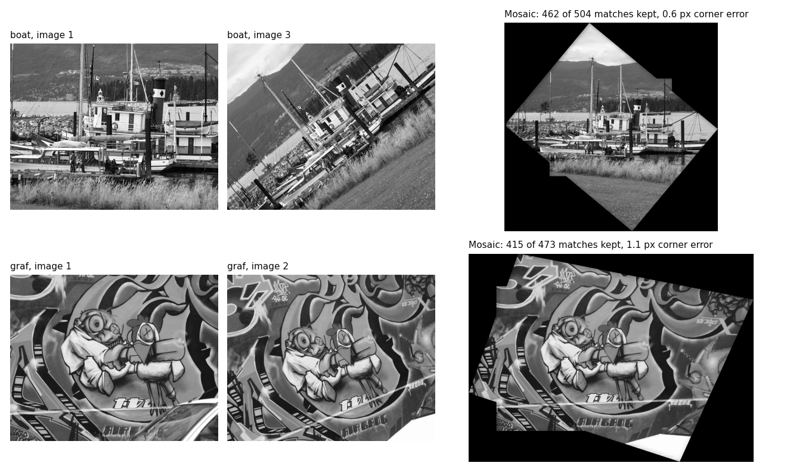

# Lines, vanishing points and stitching

This note derives what [`src/mvg/lines.py`](../../src/mvg/lines.py) and [`src/mvg/stitching.py`](../../src/mvg/stitching.py) compute. The claims marked *(tested)* are checked in [`tests/test_lines_stitching.py`](../../tests/test_lines_stitching.py) or [`tests/test_math_claims.py`](../../tests/test_math_claims.py).

## 1. Edges: Canny

1. **Gradient** with derivative-of-Gaussian filters, giving magnitude $\lVert \nabla I \rVert$ and direction.
2. **Non-maximum suppression.** An edge is a ridge of the gradient magnitude across the edge. A pixel is kept only if its magnitude is at least that of both neighbours along the gradient direction (quantised to 0°, 45°, 90° or 135°). This thins every edge to about one pixel *(tested)*.
3. **Hysteresis.** Pixels above a high threshold are edges. Pixels above a low threshold are kept only if they are connected to one of those. This keeps faint continuations of real edges and drops isolated noise.

## 2. Lines: the Hough transform

The line $y = mx + c$ cannot describe vertical lines, so use the normal form

$$
x \cos\theta + y \sin\theta = \rho, \qquad \theta \in [0, \pi),
$$

where $\rho$ is the signed distance from the origin and $\theta$ the direction of the normal. In homogeneous coordinates this is the line $\mathbf l = (\cos\theta, \sin\theta, -\rho)^\top$, and a point $\mathbf x$ lies on it exactly when $\mathbf l^\top \mathbf x = 0$.

**Voting.** A fixed point $(x, y)$ lies on every line with $\rho(\theta) = x \cos\theta + y \sin\theta$, a sinusoid in the $(\rho, \theta)$ plane. Each edge pixel adds one vote along its sinusoid. Collinear pixels' sinusoids all pass through the same $(\rho, \theta)$, so lines appear as peaks of the accumulator *(tested)*. Peaks are found as local maxima, with the $\theta$ axis wrapped around: the line $(\rho, \pi)$ is the line $(-\rho, 0)$.

**Point-line duality.** With homogeneous coordinates, the line through two points is their cross product, $\mathbf l = \mathbf x_1 \times \mathbf x_2$, and two lines meet at $\mathbf x = \mathbf l_1 \times \mathbf l_2$. Parallel image lines meet at a point with third coordinate 0: a point at infinity, in their common direction *(tested)*.

## 3. Vanishing points

Points on a 3D line with direction $\mathbf d$ are $\mathbf X(\lambda) = \mathbf A + \lambda \mathbf d$. With camera $P = K[R \mid \mathbf t]$:

$$
\mathbf x(\lambda) \sim K (R \mathbf A + \mathbf t) + \lambda\, K R\, \mathbf d
\;\xrightarrow{\ \lambda \to \infty\ }\; K R\, \mathbf d .
$$

So every 3D line with direction $\mathbf d$, wherever it is, images to a line through the same point $\mathbf v = K R \mathbf d$: the **vanishing point** of that direction *(tested)*. Conversely, a vanishing point gives the 3D direction in the camera frame, $R \mathbf d \sim K^{-1} \mathbf v$.

**Estimation.** RANSAC over pairs of lines: $\mathbf v = \mathbf l_i \times \mathbf l_j$, and line $\mathbf l$ supports $\mathbf v$ if $|\hat{\mathbf l}^\top \hat{\mathbf v}| < \epsilon$, where lines are scaled to unit normals and $\mathbf v$ to unit length, both in coordinates centred on the image and divided by its half-size (otherwise the test depends on where the origin is). The best $\mathbf v$ is refined by least squares, $\min_{\lVert \mathbf v \rVert = 1} \sum_i (\mathbf l_i^\top \mathbf v)^2$, which is the smallest right singular vector of the stacked lines, just as in the DLT. Its supporting lines are then removed and the search repeats for the next vanishing point.

**Focal length from two orthogonal directions.** If $\mathbf d_1 \perp \mathbf d_2$, then $(K^{-1}\mathbf v_1)^\top (K^{-1}\mathbf v_2) = 0$, that is

$$
\mathbf v_1^\top \underbrace{K^{-\top} K^{-1}}_{\omega} \mathbf v_2 = 0 .
$$

$\omega$ is the *image of the absolute conic*. It depends only on $K$, which is why orthogonality in the scene constrains the calibration. For square pixels, zero skew and principal point $\mathbf c$, $K = \begin{pmatrix} f & 0 & c_x \\ 0 & f & c_y \\ 0 & 0 & 1 \end{pmatrix}$. With $\mathbf a = \mathbf v_1 - \mathbf c$ and $\mathbf b = \mathbf v_2 - \mathbf c$ (inhomogeneous), $K^{-1}\mathbf v_i = (\mathbf a / f, 1)$ and the condition becomes

$$
\frac{\mathbf a^\top \mathbf b}{f^2} + 1 = 0 \quad\Longrightarrow\quad f = \sqrt{-(\mathbf v_1 - \mathbf c)^\top (\mathbf v_2 - \mathbf c)} .
$$

On a synthetic room seen by a camera with $f = 800$, with 0.3 px noise on 36 segment end points, the three recovered vanishing points are within 1° of the true directions and give $f$ within 3% *(tested)*. [`docs/vanishing_points.png`](../vanishing_points.png) shows it.

## 4. Warping

To warp an image by $H$, the code does not push input pixels forward: they would land between output pixels, leaving holes in some places and overlaps in others. Instead it loops over **output** pixels $\mathbf x'$ and samples the input at $H^{-1} \mathbf x'$ (inverse mapping). The sample falls between pixels, so it is interpolated **bilinearly**: with $x = x_0 + f_x$, $y = y_0 + f_y$,

$$
I(x, y) \approx (1 - f_x)(1 - f_y) I_{00} + f_x (1 - f_y) I_{10} + (1 - f_x) f_y I_{01} + f_x f_y I_{11} .
$$

The canvas is the bounding box of all warped image corners.

## 5. Blending

Even with exact alignment, images differ in exposure and vignetting, so simply pasting one over another leaves a visible seam.

**Feathering.** Weight each image by the distance of each pixel to its image border, $w_i(\mathbf x)$, and average: $I = \sum_i w_i I_i / \sum_i w_i$. Seams fade across the overlap, but a misalignment shows as a double image (ghosting) over the whole overlap.

**Multi-band blending** (Burt and Adelson, 1983). Split each image into a Laplacian pyramid: $L_k = G_k - \operatorname{up}(G_{k+1})$, where $G_k$ is the image blurred and halved $k$ times. Each $L_k$ holds one band of frequencies, and summing all of them (upsampling as you go) gives back the image. Blend band $k$ with the mask's Gaussian pyramid level $G_k(M)$, which is blurrier for coarser bands:

$$
L_k^{\text{blend}} = \sum_i G_k(M_i)\, L_k(I_i) .
$$

Low frequencies, such as an exposure difference, blend over a wide region, and fine detail over a narrow one. So there is neither a hard seam nor ghosting. On two flat images of brightness 0.3 and 0.7 with a hard mask, the largest step between neighbouring pixels drops from 0.4 to under 0.1 *(tested)*.

## 6. Panoramas: why homographies, and cylinders

A camera rotating about its centre sees $\mathbf x_2 \sim K R K^{-1} \mathbf x_1$ (derived in [`homography.md`](homography.md)), so a homography aligns the images exactly, whatever the scene depth. For wide panoramas this breaks down: as the rotation approaches 90°, $K R K^{-1}$ stretches the image towards infinity.

**Cylindrical projection.** Project each viewing ray onto a cylinder of radius $f$ around the camera centre. A pixel at $(x, y)$ relative to the principal point is the ray $(x, y, f)$, with angle $\theta = \operatorname{atan}(x / f)$ around the vertical axis and height $f y / \sqrt{x^2 + f^2}$ on the cylinder:

$$
x' = f\, \operatorname{atan}\frac{x}{f}, \qquad y' = \frac{f\, y}{\sqrt{x^2 + f^2}} .
$$

Panning the camera by $\alpha$ adds $\alpha$ to every ray's angle and leaves heights unchanged. So on the cylinder, images taken by a panning camera differ by a **pure horizontal shift** of $f \alpha$ pixels *(tested)*, and a full 360° panorama becomes a strip, aligned with a 1-parameter search instead of a homography.

## 7. Results on real images

Each mosaic uses only this repository: our SIFT features, the ratio test, RANSAC + normalised DLT + Levenberg-Marquardt, and multi-band blending. The ground-truth homography is used only for the error, the mean distance between the four image corners mapped by the estimated and the true homography.

| Pair | Ratio-test matches | RANSAC inliers | Corner error |
|---|---:|---:|---:|
| boat 1→3 (rotation and zoom) | 504 | 462 | 0.6 px |
| graf 1→2 (viewpoint change of a planar wall) | 473 | 415 | 1.1 px |

## References

- J. Canny, "A computational approach to edge detection", *IEEE TPAMI*, 1986.
- R. Duda and P. Hart, "Use of the Hough transformation to detect lines and curves in pictures", *Comm. ACM*, 1972.
- R. Hartley and A. Zisserman, *Multiple View Geometry*, 2nd ed., 2004: section 8.6 (vanishing points), section 8.8 (calibration from vanishing points and the image of the absolute conic).
- P. Burt and E. Adelson, "A multiresolution spline with application to image mosaics", *ACM ToG*, 1983.
- R. Szeliski, "Image alignment and stitching: a tutorial", 2006 (cylindrical panoramas).
