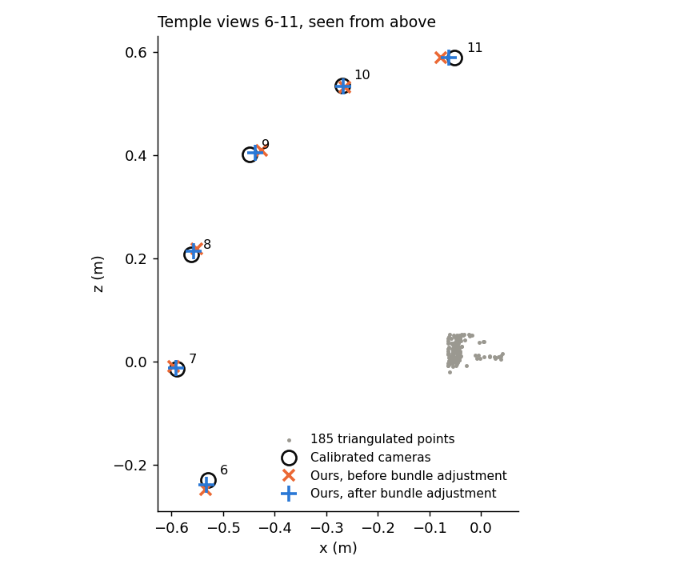

# Camera pose from 3D points (PnP) and bundle adjustment

This note derives what [`src/mvg/pnp.py`](../../src/mvg/pnp.py), [`src/mvg/bundle_adjustment.py`](../../src/mvg/bundle_adjustment.py) and [`src/mvg/sfm.py`](../../src/mvg/sfm.py) compute. The claims marked *(tested)* are checked in [`tests/test_pnp_ba.py`](../../tests/test_pnp_ba.py) or [`tests/test_math_claims.py`](../../tests/test_math_claims.py).

## 1. PnP by the DLT

With $K$ known, normalised points $\hat{\mathbf x} = K^{-1} \mathbf x$ satisfy $\hat{\mathbf x} \sim [R \mid \mathbf t]\, \mathbf X$. Writing the rows of $M = [R \mid \mathbf t]$ as $\mathbf m_1^\top, \mathbf m_2^\top, \mathbf m_3^\top$, the cross product $\hat{\mathbf x} \times M \mathbf X = 0$ gives two linear equations per point, exactly as for the homography:

$$
\begin{pmatrix} \mathbf X^\top & 0^\top & -\hat u\, \mathbf X^\top \\ 0^\top & \mathbf X^\top & -\hat v\, \mathbf X^\top \end{pmatrix}
\begin{pmatrix} \mathbf m_1 \\ \mathbf m_2 \\ \mathbf m_3 \end{pmatrix} = 0 .
$$

$M$ has 12 entries and is found up to scale, so **6 points** are needed. Without noise the solution is exact *(tested)*. The 3D points are normalised (centroid at 0, mean distance $\sqrt 3$) for the same conditioning reason as in [`homography.md`](homography.md).

The left $3 \times 3$ block is then only approximately a rotation times a scale. With its SVD $U S V^\top$, the code takes $R = U V^\top$ (the nearest rotation) and the scale as the mean singular value, $\mathbf t = \mathbf m_{\cdot 4} / \bar s$. The sign is chosen so that $\det R = +1$ and the points lie in front of the camera.

**Refinement.** Then Levenberg-Marquardt minimises the reprojection error $\sum_j \lVert \mathbf x_j - \pi(K, R, \mathbf t, \mathbf X_j) \rVert^2$ over 6 parameters (axis-angle and translation) *(tested)*. Inside RANSAC with 6-point samples, this also matches OpenCV's `solvePnPRansac` to within 0.3° *(tested)*.

**When the DLT breaks down.** The DLT treats all 12 entries of $M$ as independent. With a narrow field of view and points that span little depth, the columns of the system become nearly dependent: perspective effects are tiny, and the camera looks almost affine. Measured here with 6 points and 0.5 px noise *(tested)*:

| Setup | Median rotation error, DLT | Median rotation error, LM from a pose about 4° off |
|---|---:|---:|
| $f = 500$ px, points spread 2 units at depth 6 | 6.1° | 0.4° |
| $f = 1520$ px, points spread 0.1 at depth 2.2 (like the Middlebury temple) | 61.9° | 1.0° |

So for the temple reconstruction, each RANSAC sample is solved by Levenberg-Marquardt started from the **previous camera's pose**, which is close because consecutive views are 23° apart. Minimal solvers such as P3P or EPnP are the usual answer when no such prior exists.

## 2. Bundle adjustment

Given cameras $(R_i, \mathbf t_i)$ and points $\mathbf X_j$ from the steps before, bundle adjustment minimises the reprojection error over **all of them at once**:

$$
\min_{\{R_i, \mathbf t_i\},\ \{\mathbf X_j\}} \; \sum_{(i, j) \in \text{observed}} \left\lVert \mathbf x_{ij} - \pi(K R_i \mathbf X_j + K \mathbf t_i) \right\rVert^2 .
$$

### Jacobians

Each residual $\mathbf r_{ij}$ (2 numbers) depends on one camera and one point. With the camera-frame point $\mathbf X^c = R \mathbf X + \mathbf t = (x, y, z)$ and the pixel $u = f_x x / z + c_x$, $v = f_y y / z + c_y$:

$$
\frac{\partial (u, v)}{\partial \mathbf X^c} =
\begin{pmatrix} f_x / z & 0 & -f_x x / z^2 \\ 0 & f_y / z & -f_y y / z^2 \end{pmatrix} .
$$

The chain rule then gives the three blocks:

- **Point:** $\partial \mathbf X^c / \partial \mathbf X = R$.
- **Translation:** $\partial \mathbf X^c / \partial \mathbf t = I$.
- **Rotation:** rotations are updated multiplicatively, $R \leftarrow \exp([\boldsymbol\omega]_\times) R$, so that the update has exactly 3 parameters and no singularity. To first order $\exp([\boldsymbol\omega]_\times) R \mathbf X \approx R \mathbf X + \boldsymbol\omega \times R \mathbf X$, so
$$
\frac{\partial \mathbf X^c}{\partial \boldsymbol\omega}\bigg|_{\boldsymbol\omega = 0} = -[R \mathbf X]_\times .
$$

The code checks these analytic blocks against numerical differences *(tested)*.

### Sparse structure and the Schur complement

Order the unknowns as cameras $\mathbf c$ (6 each) then points $\mathbf p$ (3 each). With $A_{ij} = \partial \mathbf r_{ij} / \partial \mathbf c_i$ and $B_{ij} = \partial \mathbf r_{ij} / \partial \mathbf p_j$, the Gauss-Newton system $J^\top J\, \boldsymbol\delta = -J^\top \mathbf r$ has the block form

$$
\begin{pmatrix} U & W \\ W^\top & V \end{pmatrix}
\begin{pmatrix} \boldsymbol\delta_c \\ \boldsymbol\delta_p \end{pmatrix}
= -\begin{pmatrix} \mathbf g_c \\ \mathbf g_p \end{pmatrix},
\qquad
U_i = \sum_j A_{ij}^\top A_{ij},\quad
V_j = \sum_i B_{ij}^\top B_{ij},\quad
W_{ij} = A_{ij}^\top B_{ij} .
$$

**$V$ is block-diagonal**, because no residual involves two points. Eliminating $\boldsymbol\delta_p$ from the second row, $\boldsymbol\delta_p = -V^{-1}(\mathbf g_p + W^\top \boldsymbol\delta_c)$, and substituting gives the **reduced camera system**

$$
\left(U - W V^{-1} W^\top\right) \boldsymbol\delta_c = -\mathbf g_c + W V^{-1} \mathbf g_p .
$$

It is only $6m \times 6m$ for $m$ cameras, however many points there are, and $V^{-1}$ costs one $3 \times 3$ inverse per point. The points are then updated one by one. Levenberg-Marquardt damps the diagonal blocks of $U$ and $V$ before eliminating. The step equals the one from solving the full dense system *(tested)*.

### Gauge freedom

Rotating, translating or scaling the whole reconstruction leaves every reprojection error unchanged: 7 directions in which the cost is flat, so $J^\top J$ is singular. Holding the first camera fixed removes 6 of them. The scale remains, and the damping keeps it from drifting. While testing the Schur step against the dense solve, the dense $J^\top J$ with only one camera fixed turned out to be singular for exactly this reason. Fixing a second camera made the two steps agree *(tested)*.

### Comparing with ground truth

A reconstruction from images alone is only defined up to a similarity transform. To compare camera centres with the truth, the code first finds the similarity $(s, R, \mathbf t)$ minimising $\sum_i \lVert \mathbf C_i^{\text{true}} - (s R\, \mathbf C_i + \mathbf t) \rVert^2$ in closed form (Umeyama, 1991) *(tested)*: centre both point sets, take the SVD of their cross-covariance, $U D V^\top$, and set $R = U S V^\top$, with $S = \operatorname{diag}(1, 1, \pm 1)$ chosen so that $\det R = +1$.

## 3. Results

**Synthetic ring** (6 cameras, 200 points, 0.5 px noise, cameras perturbed by about 1° and 0.1 units): bundle adjustment brings the RMS reprojection error from above 5 px to the noise level, never increases the cost, and recovers the camera centres to within 0.05 units after alignment *(tested)*.

**Middlebury temple, views 6 to 11** (consecutive views 23° apart), using only this repository: our SIFT, a two-view start with the essential matrix, PnP for each new view, triangulation, then bundle adjustment. It reconstructs 6 cameras, 185 points and 434 observations.

| | Median rotation error | Largest rotation error | Median camera-centre error | RMS reprojection error |
|---|---:|---:|---:|---:|
| Before bundle adjustment | 4.6° | 7.2° | 8.5% of camera spacing | 0.65 px |
| After bundle adjustment | **1.3°** | **2.4°** | **3.7%** | **0.35 px** |

## References

- R. Hartley and A. Zisserman, *Multiple View Geometry*, 2nd ed., 2004: chapter 7 (computing P), section 18.1 and appendix 6 (bundle adjustment and sparse Levenberg-Marquardt).
- B. Triggs, P. McLauchlan, R. Hartley and A. Fitzgibbon, "Bundle adjustment: a modern synthesis", 1999.
- V. Lepetit, F. Moreno-Noguer and P. Fua, "EPnP: an accurate O(n) solution to the PnP problem", IJCV 2009.
- S. Umeyama, "Least-squares estimation of transformation parameters between two point patterns", *IEEE TPAMI*, 1991.
