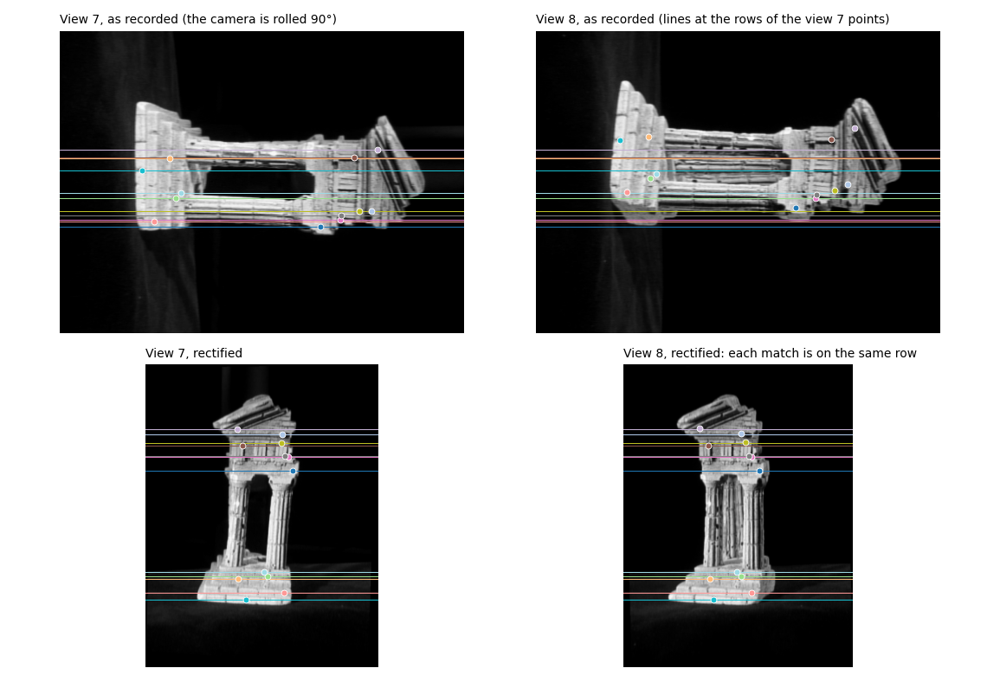
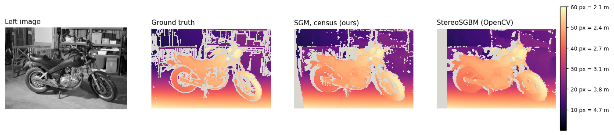

# Stereo: rectification, disparity and depth

This note derives what [`src/mvg/stereo.py`](../../src/mvg/stereo.py) computes. The claims marked *(tested)* are checked in [`tests/test_stereo.py`](../../tests/test_stereo.py) or [`tests/test_math_claims.py`](../../tests/test_math_claims.py).

## 1. Depth from disparity

Take two identical cameras side by side, looking the same way, with their centres a distance $B$ (the **baseline**) apart along the $x$ axis. A point at $(X, Y, Z)$ in the left camera's frame is at $(X - B, Y, Z)$ in the right one's, so with focal length $f$:

$$
x_L = f \frac{X}{Z}, \qquad x_R = f \frac{X - B}{Z}, \qquad y_L = y_R .
$$

The point appears on the **same row** in both images, shifted by the **disparity**

$$
d = x_L - x_R = \frac{f B}{Z}
\qquad\Longleftrightarrow\qquad
Z = \frac{f B}{d}
$$

*(tested)*. Near points shift a lot, far points hardly at all. If the two cameras' principal points differ by $d_\text{offs}$ along $x$ (as in the Middlebury data), $Z = f B / (d + d_\text{offs})$.

**Precision falls with distance.** Differentiating, an error of $\Delta d$ pixels in disparity gives a depth error

$$
\Delta Z \approx \frac{Z^2}{f B}\, \Delta d ,
$$

so doubling the distance makes depth four times less precise. A longer baseline or a longer focal length helps *(tested)*.

## 2. Rectification

Real stereo cameras are never exactly parallel, so matches do not lie on the same row. **Rectification** warps both images to what two parallel cameras at the same centres would have seen (Fusiello, Trucco and Verri, 2000).

Rotating a camera about its own centre changes its image by a homography, independent of the scene (derived in [`homography.md`](homography.md)): if the old camera is $K R$ and the new one $K' R'$, then

$$
\mathbf x' \sim K' R' R^{-1} K^{-1} \mathbf x = T\, \mathbf x .
$$

So it is enough to choose one new orientation $R'$ for both cameras, with rows:

1. $\mathbf r_1$, the new $x$ axis: along the baseline, $(\mathbf C_2 - \mathbf C_1) / \lVert \mathbf C_2 - \mathbf C_1 \rVert$, so that both centres lie on the new $x$ axis;
2. $\mathbf r_2 = \mathbf k \times \mathbf r_1$ (normalised), where $\mathbf k$ is the old optical axis of camera 1: orthogonal to the baseline, and close to the old "down";
3. $\mathbf r_3 = \mathbf r_1 \times \mathbf r_2$, the new optical axis.

Both cameras get the same $K'$ (the mean of the two). Then the new cameras differ only by a shift along their own $x$ axis, which is exactly the setup of section 1: matches lie on the same row, and $x_1 - x_2 = f B / Z$ *(tested)*.

On temple views 7 and 8 (calibrated, 23° apart), the median row difference between our SIFT matches drops from 34.6 px to 0.24 px after rectification. These cameras happen to be rolled by about 90°, so the rectified views also come out upright.

## 3. Matching costs

For each pixel and each candidate disparity $d$, a cost $C(x, y, d)$ says how different the left pixel $(x, y)$ is from the right pixel $(x - d, y)$. All costs together form the **cost volume**, of size $D \times H \times W$.

- **SAD** (sum of absolute differences): $|I_L(x, y) - I_R(x - d, y)|$, summed over a window. It is simple, but any exposure difference between the cameras counts as a mismatch.
- **Census** (Zabih and Woodfill, 1994): replace each pixel by a bit string, one bit per neighbour in a window, $b_k = [I(\mathbf n_k) < I(\mathbf p)]$, and compare bit strings with the Hamming distance. Each bit depends only on the *order* of two intensities, so any increasing change of brightness, such as gain, offset or gamma, leaves the census unchanged *(tested)*. The code uses a $5 \times 7$ window (34 bits).

## 4. Block matching

Sum the cost over a window around each pixel (a box filter on each disparity slice of the volume), and take the disparity with the lowest sum: **winner-take-all**. A box filter costs the same whatever the window size (see the integral image in [`features.md`](features.md)).

**Sub-pixel disparity.** Fit a parabola through the costs at $d - 1$, $d$, $d + 1$. Its minimum is at

$$
d^* = d + \frac{C_{d-1} - C_{d+1}}{2\,(C_{d-1} - 2 C_d + C_{d+1})} ,
$$

which recovers a shift of 3.4 px to within 0.15 px *(tested)*.

**Left-right check.** Compute the disparity of the right image from the same cost volume, and keep a left disparity only if the right image points back to it: $|d_L(x) - d_R(x - d_L(x))| \le 1$. This removes **occluded** pixels, which are visible in only one image and so have no correct match, along with most mismatches *(tested)*.

## 5. Semi-global matching

Block matching decides each pixel on its own. Real disparity maps are mostly smooth, with jumps at object edges. The ideal is to minimise

$$
E(D) = \sum_{\mathbf p} C(\mathbf p, D_\mathbf p) + \sum_{\mathbf p, \mathbf q \text{ neighbours}} \Big( P_1 [|D_\mathbf p - D_\mathbf q| = 1] + P_2 [|D_\mathbf p - D_\mathbf q| > 1] \Big) .
$$

A small penalty $P_1$ allows slanted surfaces, and a larger $P_2$ allows depth jumps but makes them cost something. Minimising this over the whole 2D image is NP-hard, but along a single line it can be done exactly by dynamic programming. **SGM** (Hirschmüller, 2008) runs that along several straight paths $\mathbf r$ through each pixel:

$$
L_\mathbf r(\mathbf p, d) = C(\mathbf p, d) + \min\Big( L_\mathbf r(\mathbf p - \mathbf r, d),\ L_\mathbf r(\mathbf p - \mathbf r, d \pm 1) + P_1,\ \min_k L_\mathbf r(\mathbf p - \mathbf r, k) + P_2 \Big) - \min_k L_\mathbf r(\mathbf p - \mathbf r, k) .
$$

Subtracting the last term keeps the values bounded and does not change which $d$ is smallest. The path costs are summed, $S(\mathbf p, d) = \sum_\mathbf r L_\mathbf r(\mathbf p, d)$, and winner-take-all, the sub-pixel fit and the left-right check are applied to $S$. The code uses 4 paths (left, right, up, down) on a census cost summed over $3 \times 3$. On a noisy synthetic scene of two planes it makes fewer errors than block matching *(tested)*.

## 6. Results on the Middlebury motorcycle

The pair is from the Middlebury 2014 benchmark, down-sampled 4 times and bundled with scikit-image, with ground-truth disparity (7 to 60 px) and calibration ($f = 995$ px, $B = 193$ mm). A pixel is **bad** if its disparity is off by more than 2 px. Density is the fraction of ground-truth pixels for which a method gives a disparity at all.

| Method | Density | Bad pixels among those given | Bad, counting missing as bad | Time |
|---|---:|---:|---:|---:|
| Block matching, SAD (ours) | 77% | 11.8% | 32.3% | 0.3 s |
| Block matching, census (ours) | 89% | **4.4%** | 15.4% | 0.7 s |
| SGM, census (ours) | **91%** | 4.9% | **13.7%** | 1.1 s |
| StereoBM (OpenCV) | 78% | 6.9% | 27.0% | 0.01 s |
| StereoSGBM (OpenCV) | 87% | 6.1% | 18.3% | 0.04 s |

Census is the clearest gain: it more than halves the bad pixels of SAD. SGM fills in more of the image than block matching, at a similar error rate. OpenCV's methods were run with common settings, not tuned for this image. Our SGM's own penalties ($P_1 = 8$, $P_2 = 64$) were checked against three larger pairs on this same image and kept, so its numbers are slightly optimistic. OpenCV is 25 to 30 times faster.

## References

- A. Fusiello, E. Trucco and A. Verri, "A compact algorithm for rectification of stereo pairs", *Machine Vision and Applications*, 2000.
- R. Zabih and J. Woodfill, "Non-parametric local transforms for computing visual correspondence", ECCV 1994 (census).
- H. Hirschmüller, "Stereo processing by semiglobal matching and mutual information", *IEEE TPAMI*, 2008.
- D. Scharstein and R. Szeliski, "A taxonomy and evaluation of dense two-frame stereo correspondence algorithms", *IJCV*, 2002.
- D. Scharstein et al., "High-resolution stereo datasets with subpixel-accurate ground truth", GCPR 2014 (the motorcycle pair).
